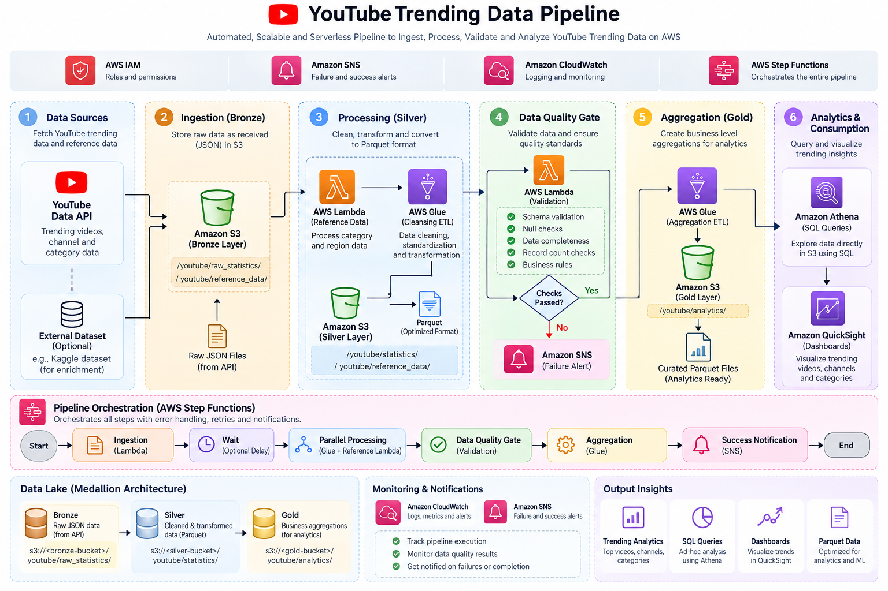

# YouTube Trending Data Pipeline
### Serverless Data Engineering on AWS | Bronze → Silver → Gold

A cloud-native data pipeline that collects trending YouTube video data, stores the raw records in Amazon S3, transforms them into analytics-ready datasets, validates data quality, and orchestrates the workflow using AWS Step Functions.

---

## Table of Contents

1. [Project Overview](#1-project-overview)
2. [Problem Statement](#2-problem-statement)
3. [Project Goals](#3-project-goals)
4. [Architecture](#4-architecture)
5. [Medallion Architecture](#5-medallion-architecture)
6. [End-to-End Workflow](#6-end-to-end-workflow)
7. [Technology Stack](#7-technology-stack)
8. [AWS Resources](#8-aws-resources)
9. [Repository Structure](#9-repository-structure)
10. [Data Quality Framework](#10-data-quality-framework)
11. [Data Layout and Formats](#11-data-layout-and-formats)
12. [Configuration](#12-configuration)
13. [Running the Pipeline](#13-running-the-pipeline)
14. [Querying Data with Athena](#14-querying-data-with-athena)
15. [Monitoring and Troubleshooting](#15-monitoring-and-troubleshooting)
16. [Security](#16-security)
17. [Validation Results](#17-validation-results)
18. [Limitations and Future Enhancements](#18-limitations-and-future-enhancements)
19. [Learning Outcomes](#19-learning-outcomes)

---

## 1. Project Overview

The **YouTube Trending Data Pipeline** is an end-to-end data engineering project built with Python and AWS services. It ingests trending video information from the YouTube Data API v3 for configured regions and processes the data through a three-layer data lake.

The pipeline uses:

- **Amazon S3** for Bronze, Silver, and Gold storage.
- **AWS Lambda** for API ingestion, reference-data transformation, and data-quality validation.
- **AWS Glue / PySpark** for large-scale data transformation.
- **AWS Glue Data Catalog** to manage table metadata.
- **AWS Step Functions** to orchestrate processing, parallel branches, decisions, and notifications.
- **Amazon Athena** to query cataloged datasets with SQL.
- **Amazon SNS** to publish pipeline notifications.
- **Amazon CloudWatch** to inspect logs and diagnose execution issues.
- **AWS IAM** to control access between services.

The goal is to demonstrate how a serverless AWS workflow can turn raw API responses into structured, validated data for downstream analytics.

## 2. Problem Statement

Raw API responses are not immediately suitable for reliable analysis. They can contain nested structures, inconsistent data types, missing values, repeated records, and reference identifiers that require additional interpretation.

This project addresses those challenges by creating a repeatable workflow to:

1. Collect data from a live API.
2. Preserve the raw source records.
3. clean and standardize the data.
4. validate data before promoting it to the analytics layer.
5. orchestrate dependent cloud tasks and notify on completion or failure.
6. expose processed data through a catalog for SQL analysis.

## 3. Project Goals

- Ingest trending videos for a configurable set of regions.
- Store source responses in Amazon S3 in JSON format.
- Transform raw records into cleaned, columnar Parquet datasets.
- Apply the **Medallion Architecture: Bronze → Silver → Gold**.
- Process reference data separately from video statistics.
- Run data-quality checks before Gold-layer processing.
- Use Step Functions for workflow orchestration and conditional execution.
- Use SNS to send status notifications.
- Make curated data available to Athena through the Glue Data Catalog.

---

## 4. Architecture

## 4. Architecture

The following diagram illustrates the end-to-end architecture of the
YouTube Trending Data Pipeline, including data ingestion, AWS processing,
data quality validation, analytics, and workflow orchestration.

<p align="center">
  
</p>

### Orchestration behavior

- Step Functions starts the ingestion Lambda.
- A short wait allows ingestion writes to complete before downstream processing.
- Reference-data conversion and Bronze-to-Silver transformation execute in a **Parallel** state.
- The data-quality Lambda checks the Silver dataset.
- A **Choice** state evaluates the quality result.
- The Silver-to-Gold Glue job runs when quality passes.
- SNS publishes the configured success or failure notification.

**Important dependency note:** Parallel branches are safe only when they do not require each other's outputs during the same execution. If a Glue job reads reference data produced by the other branch, add a dependency/wait step or restructure the workflow so that the required reference output exists before the dependent job begins.

---

## 5. Medallion Architecture

The project organizes data into three logical layers. Each layer has a different purpose and quality expectation.

```text
                   MEDALLION DATA ARCHITECTURE

┌─────────────────────────────────────────────────────────────┐
│ SOURCE                                                      │
│ YouTube Data API v3                                         │
│ Trending video records + category reference records         │
└────────────────────────────┬────────────────────────────────┘
                             │
                             ▼
┌─────────────────────────────────────────────────────────────┐
│ BRONZE — RAW / SOURCE-ALIGNED                               │
│ Amazon S3 | JSON                                             │
│ • Stores source API responses                                │
│ • Preserves ingestion metadata                               │
│ • Organizes data by region, date, and hour where applicable │
└────────────────────────────┬────────────────────────────────┘
                             │ AWS Glue / Lambda
                             ▼
┌─────────────────────────────────────────────────────────────┐
│ SILVER — CLEANED / STANDARDIZED                             │
│ Amazon S3 | Parquet                                          │
│ • Flattens nested structures                                │
│ • Standardizes data types and region values                 │
│ • Handles invalid or missing values as configured           │
│ • Removes duplicates and derives metrics where configured   │
│ • Keeps video statistics and reference data organized       │
└────────────────────────────┬────────────────────────────────┘
                             │ Data Quality Gate
                             ▼
                    ┌──────────────────┐
                    │ Quality Passed?  │
                    └────────┬─────────┘
                             │ Yes
                             ▼
┌─────────────────────────────────────────────────────────────┐
│ GOLD — CURATED / ANALYTICS-READY                            │
│ Amazon S3 | Parquet                                          │
│ • Output of the Silver-to-Gold Glue job                     │
│ • Intended for aggregations and downstream analysis         │
│ • Cataloged for SQL querying where configured               │
└────────────────────────────┬────────────────────────────────┘
                             │
                             ▼
                    Amazon Athena / SQL
```

### Bronze layer

**Purpose:** Preserve source data for traceability and reprocessing.

- Stores raw YouTube API JSON responses.
- Keeps trending statistics separate from category reference data.
- Uses S3 prefixes that include region and time partitions where configured.
- Minimizes transformation so that source records remain available for debugging and reprocessing.

Example key patterns:

```text
s3://<bronze-bucket>/youtube/raw_statistics/region=US/date=YYYY-MM-DD/hour=HH/<ingestion-id>.json
s3://<bronze-bucket>/youtube/raw_statistics_reference_data/region=US/date=YYYY-MM-DD/US_category_id.json
```

These are key-pattern examples; use the actual casing and prefixes present in your S3 bucket.

### Silver layer

**Purpose:** Create consistent and query-friendly datasets from raw records.

- Flattens nested JSON fields where supported by the Glue job.
- Converts numeric fields such as views and likes to appropriate data types.
- Standardizes region identifiers and data fields.
- Applies null handling and duplicate removal as implemented.
- Derives engagement metrics if configured in the transformation.
- Writes columnar Parquet output and updates the Glue Data Catalog.

Typical logical datasets include cleaned video statistics and category reference data. Actual S3 paths and catalog table names are determined by the deployed code and job parameters.

### Gold layer

**Purpose:** Provide curated data for reporting and analysis.

- Is produced by the Silver-to-Gold Glue job after the quality gate passes.
- Contains the curated output defined by that job.
- Is intended for analytical SQL queries through Athena.
- Should be validated against the actual Glue table schema before use.

Do not assume Gold table names or columns without checking the deployed Glue job and Data Catalog.

---

## 6. End-to-End Workflow

| Step | Component | Responsibility |
|---|---|---|
| 1 | YouTube Data API v3 | Supplies trending video and category information |
| 2 | Ingestion Lambda | Calls the API for each configured region |
| 3 | Bronze S3 | Stores raw JSON responses |
| 4 | Step Functions Wait state | Pauses briefly before transformation |
| 5a | Reference transformation Lambda | Converts category reference JSON into Parquet |
| 5b | Bronze-to-Silver Glue job | Cleans and transforms video statistics |
| 6 | Glue Data Catalog | Provides table metadata for querying |
| 7 | Data-quality Lambda | Runs validation checks against Silver data |
| 8 | Choice state | Determines whether quality passed |
| 9 | Silver-to-Gold Glue job | Builds curated output when the gate passes |
| 10 | SNS | Publishes configured success or failure notifications |
| 11 | Athena | Queries cataloged datasets using SQL |

The exact input and output JSON for each state is defined by the state machine. Inspect execution history when diagnosing a failed run.

---

## 7. Technology Stack

| Category | Technology | Use |
|---|---|---|
| API | YouTube Data API v3 | Source data |
| Language | Python | Lambda and pipeline logic |
| Cloud storage | Amazon S3 | Data lake layers |
| Serverless compute | AWS Lambda | Ingestion, reference transformation, quality checks |
| ETL | AWS Glue / PySpark | Distributed transformations |
| Workflow | AWS Step Functions | Task orchestration, parallel execution, branching |
| Metadata | AWS Glue Data Catalog | Database, table, and partition metadata |
| Query engine | Amazon Athena | SQL analysis |
| Notifications | Amazon SNS | Success/failure notifications |
| Logging | Amazon CloudWatch | Logs and troubleshooting |
| Permissions | AWS IAM | Service access control |
| Data formats | JSON, Parquet | Raw and processed storage |

---

## 8. AWS Resources

The current development setup uses **AWS Asia Pacific (Mumbai), `ap-south-1`**.

| Resource | Configured name |
|---|---|
| Bronze S3 bucket | `data-pipeline-bronze-youtube` |
| Silver S3 bucket | `data-pipeline-silver-youtube` |
| Gold S3 bucket | `data-pipeline-gold-youtube` |
| Scripts S3 bucket | `data-pipeline-script-youtube` |
| Athena query-results bucket | `yt-pipeline-athena-query-result` |
| SNS topic | `yt-data-pipeline-alerts` |
| Bronze Glue database | `yt-pipeline-bronze` |
| Silver Glue database | `yt-pipeline-silver` |
| Gold Glue database | `yt-pipeline-gold` |
| Ingestion Lambda | `yt-data-pipeline-youtube-ingestion` |
| Reference transformation Lambda | `data-pipeline-json-to-parquet` |
| Data-quality Lambda | `yt-data-pipeline-data-quality` |
| Step Functions state machine | `yt-data-pipeline-orchestrator` |

Glue job names used by the orchestration configuration are expected to be:

- `yt-data-pipeline-bronze-to-silver`
- `yt-data-pipeline-silver-to-gold`

Verify these names against the jobs in your AWS account before running or redeploying the state machine.

These are deployment-specific names, not universal defaults. Replace them when deploying to another AWS account.

---

## 9. Repository Structure

Keep this diagram synchronized with the files actually committed to Git. Cloud resources configured only in the AWS Console are not automatically stored in the repository.

```text
YouTube-Trending-Data-Pipeline/
│
├── lambda/
│   ├── youtube_api_integstion/
│   │   └── lambda_function.py
│   ├── json_to_parquet/
│   │   └── lambda_function.py
│   └── data_quality/
│       └── lambda_function.py
│
├── glue_jobs/
│   ├── bronze_to_silver_statistics.py
│   └── silver_to_gold_analytics.py
│
├── step_functions/
│   └── pipeline_orchestration.json
│
├── iam_permission/
│   └── <IAM policy JSON files>
│
├── scripts/
│   ├── aws_copy.sh
│   └── information.md
│
├── data/
│   └── <small reference files, if required>
│
├── .gitignore
└── README.md
```

Some components may currently exist only in AWS or under different local filenames. Before committing, compare this illustrative structure with `git status` and the actual project directory, and update the paths to match the files you maintain.

---

## 10. Data Quality Framework

The data-quality Lambda queries the Silver table using Athena and returns a result that Step Functions evaluates before proceeding to Gold.

### Checks implemented in the current test version

| Check | Validation purpose |
|---|---|
| Row count | Ensures the dataset has at least the configured minimum number of rows |
| Critical-field null rates | Checks null percentages for required columns |
| Schema | Confirms required columns exist |
| View-count sanity | Flags negative or implausibly high view counts |
| Freshness | Checks whether the latest record is within the configured time window |

The tested configuration used a minimum row count of 10, a maximum null rate of 5%, a 50-billion view-count sanity threshold, and a 48-hour freshness window. Confirm these thresholds against the currently deployed Lambda before changing or redeploying it.

### Quality-gate behavior

```text
Silver data
    │
    ▼
Athena validation queries
    │
    ▼
Data-quality result
    │
    ▼
Step Functions Choice
    ├── PASS → Silver-to-Gold Glue job → Success notification
    └── FAIL → Failure/quality notification
```

A failed quality check should prevent promotion to Gold. Confirm that failure branches and retries in the deployed state machine match this intended behavior.

---

## 11. Data Layout and Formats

| Layer | Typical format | Purpose |
|---|---|---|
| Bronze | JSON | Preserve API responses and source structure |
| Silver | Parquet | Store cleaned, typed, query-efficient data |
| Gold | Parquet, if configured by the Gold job | Store curated analytics output |

Parquet is columnar and is generally well suited to analytical workloads because query engines can read only the columns they need. Compression and partitioning choices should be confirmed in the deployed Glue jobs.

### Partitioning

The raw ingestion path uses region and time-based prefixes. The transformation jobs may use region partitions for processed datasets. Ensure that:

- Region values use a consistent convention.
- Glue catalog partitions match the S3 paths.
- Crawlers or catalog updates do not mix unrelated schemas.
- Raw video statistics and category reference JSON are cataloged separately.

---

## 12. Configuration

### Ingestion Lambda

| Environment variable | Purpose |
|---|---|
| `YOUTUBE_API_KEY` | API key for YouTube Data API v3 |
| `S3_BUCKET_BRONZE` | Destination Bronze bucket |
| `YOUTUBE_REGIONS` | Comma-separated region codes |
| `SNS_ALERT_TOPIC_ARN` | Optional alert topic ARN |

Example region value:

```text
US,GB,CA,IN
```

### Reference transformation Lambda

| Environment variable | Purpose |
|---|---|
| `S3_BUCKET_SILVER` | Silver destination bucket |
| `GLUE_DB_SILVER` | Silver Glue database |
| `GLUE_TABLE_REFERENCE` | Reference-data table name |
| `SNS_ALERT_TOPIC_ARN` | Optional notification topic ARN |

### Data-quality Lambda

| Environment variable | Purpose |
|---|---|
| `SNS_ALERT_TOPIC_ARN` | SNS topic ARN |
| `ATHENA_OUTPUT_LOCATION` | S3 location for Athena query results |
| `ATHENA_WORKGROUP` | Athena workgroup, usually `primary` |

Use the variable names actually read by the deployed code. Do not commit API keys, credentials, or secret values in this README or in source control.

---

## 13. Running the Pipeline

### Run from the AWS Console

1. Open the AWS Console and select **Asia Pacific (Mumbai), `ap-south-1`**.
2. Open **Step Functions**.
3. Select `yt-data-pipeline-orchestrator` or the actual state-machine name in your account.
4. Choose **Start execution**.
5. Enter a unique execution name.
6. If the state machine does not require input, use:

   ```json
   {}
   ```

7. Start the execution and follow the visual state graph.
8. If a state fails, open its details and inspect the error, input/output, and related CloudWatch logs.

### Run with AWS CLI

After configuring the AWS CLI and confirming the state-machine ARN:

```bash
aws stepfunctions start-execution \
  --region ap-south-1 \
  --state-machine-arn <state-machine-arn> \
  --input '{}'
```

Replace `<state-machine-arn>` with the ARN of your deployed state machine.

### Before a run

- Confirm the YouTube API key is valid and has API access enabled.
- Check Lambda environment variables.
- Confirm S3 bucket names and IAM permissions.
- Verify Glue databases, tables, and job names.
- Confirm Athena's output location exists and is writable.
- Confirm the SNS topic ARN and email subscription.
- Ensure required source data and catalog partitions are available.

---

## 14. Querying Data with Athena

Athena can query data registered in the Glue Data Catalog. First inspect the actual databases, tables, and columns in the Athena or Glue console.

Example query pattern for a Gold table:

```sql
SELECT
    region,
    COUNT(*) AS record_count,
    SUM(views) AS total_views
FROM <gold_database>.<gold_table>
GROUP BY region
ORDER BY total_views DESC;
```

This is a template, not a guaranteed ready-to-run query. Replace the database and table placeholders and confirm that the selected table contains `region` and `views` columns.

---

## 15. Monitoring and Troubleshooting

| Symptom | What to check |
|---|---|
| Ingestion Lambda fails | API key, API quota, region code, Lambda logs, S3 write permissions |
| No new Bronze files | Lambda output, bucket name, S3 prefix, IAM permissions |
| Glue job fails | Job arguments, catalog schema, partition casing, Spark logs, S3 access |
| Reference transformation fails | Source JSON structure, Lambda dependencies, Silver write permissions |
| Athena query fails | Database/table name, catalog schema, workgroup, query-results S3 location |
| Data-quality check fails | Row count, null rates, required fields, view values, freshness |
| Step Functions state fails | State input/output, task error, role permissions, retry configuration |
| SNS notification missing | Correct topic ARN, `sns:Publish` permission, confirmed subscription |

Use the Step Functions execution graph to locate the first failing state, then inspect its CloudWatch logs. Fix the underlying error before rerunning the full workflow.

---

## 16. Security

- Keep `YOUTUBE_API_KEY` and any credentials out of Git.
- Never commit AWS access keys, secret keys, session tokens, or private keys.
- Use IAM roles with least-privilege access for Lambda, Glue, and Step Functions.
- Scope S3 access to the required buckets and prefixes wherever possible.
- Restrict access to Athena query results and raw data according to your needs.
- Avoid publishing sensitive account-specific information in public examples.
- Review staged files before committing:

  ```bash
  git status
  git diff --cached
  ```

- Ensure `.gitignore` excludes `.env`, virtual environments, credentials, and large generated files.

---

## 17. Validation Results

The observed Step Functions test execution completed successfully through ingestion, the parallel processing stage, data-quality evaluation, Silver-to-Gold processing, and the success-notification state.

A separate data-quality Lambda test returned:

```json
{
  "quality_passed": true,
  "checks_passed": 9,
  "checks_total": 9
}
```

The test read a sample of 10,000 rows from the Silver table. These results confirm that the tested execution passed; they do not guarantee that all records or future executions will always pass.

For a fresh end-to-end validation:

1. Run the Step Functions state machine.
2. Confirm new files are present in Bronze and Silver.
3. Inspect the data-quality output from that same execution.
4. Confirm the Gold job produced the expected output.
5. Query the actual Gold table with Athena.
6. Confirm the SNS notification was delivered.

---

## 18. Limitations and Future Enhancements

Potential next improvements:

- Add a scheduled trigger using Amazon EventBridge.
- Add automated infrastructure deployment with AWS SAM, CDK, Terraform, or CloudFormation.
- Add automated tests for parsing, transformations, and data-quality rules.
- Improve incremental processing and idempotency.
- Add schema evolution and partition-repair procedures.
- Add CloudWatch metrics and dashboards for row counts, failures, duration, and freshness.
- Add tested Athena queries and document the actual Gold schemas.
- Review branch dependencies so parallel execution never races on required data.
- Add a cost and quota section for API usage, Glue runs, Athena scans, and S3 storage.

These are suggested enhancements, not claims that each feature is currently deployed.

## 19. Learning Outcomes

This project provides hands-on experience with:

- Building a serverless ingestion process with Python and AWS Lambda.
- Designing an S3 data lake with the medallion architecture.
- Transforming nested JSON into structured Parquet datasets.
- Using AWS Glue and PySpark for ETL.
- Managing schemas and tables with the Glue Data Catalog.
- Orchestrating parallel tasks and conditional flows with Step Functions.
- Applying a data-quality gate before downstream processing.
- Querying cataloged datasets using Athena SQL.
- Sending pipeline status notifications with SNS.
- Debugging AWS permissions, service configuration, and execution logs.

---

**Project:** YouTube Trending Data Pipeline  
**Primary region:** `ap-south-1`  
**Architecture pattern:** Medallion Data Lake (Bronze → Silver → Gold)  
**Orchestration:** AWS Step Functions
